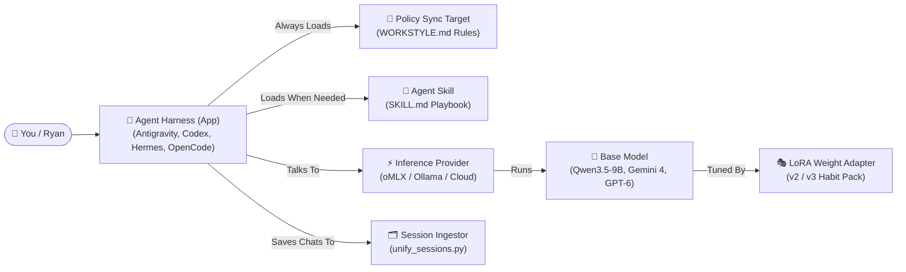

# Plain-English Dictionary (Untangling Overloaded Words)

> [!TIP]
> **Why This Page Exists**: In AI projects, people say **"adapter"**, **"harness"**, **"model"**, and **"skill"** to mean five different things. This page gives each piece of our setup one clear name so we never talk past each other.

---

## 1. Three Things That Used to Be Called "Adapter"

Why "adapter" was confusing: three totally unrelated scripts in our repos used the word "adapter":

| Casual Word | What You're Actually Talking About | Clear Name & Link | What It Does in Plain English |
|---|---|---|---|
| *"Model adapter"* / *"LoRA"* | Fine-tuning on the GPU server (`v2`/`v3`, `Qwen3.5-9B`) | **[[20.02-LoRA-Weight-Adapter]]** | A small "personality & habit pack" layered on top of a [[20.01-Base-Model]] so it follows tool rules without retraining the whole brain. |
| *"Policy adapter"* / *"Rules file"* | `WORKSTYLE.md`, `sync_policy.py`, `AGENTS.md`, `SOUL.md` | **[[40.02-Policy-Sync-Target]]** | The instruction file inside each AI app (`AGENTS.md` or `SOUL.md`) that receives our shared rules automatically. |
| *"Session adapter"* / *"Ingestor"* | `unify_sessions.py`, chat logs from 9 apps | **[[40.04-Session-Ingestor]]** | A converter script that reads chat histories from 9 different AI apps and saves them in one clean format. |

---

## 2. Two Things Called "Harness"

| Clear Name | Note | What It Does in Plain English | Examples |
|---|---|---|---|
| **Agent Harness** *(The App)* | [[10.01-Agent-Harness]] | The **app or CLI you actually type into**. It wraps around an AI model, gives it tools (like reading files or running terminal commands), and shows you the chat. | [[10.02-Antigravity-AGY]], [[10.03-Codex-CLI-and-Spark]], [[10.04-Hermes-Agent]], [[10.05-OpenCode-and-Maestri]] |
| **Evaluation Harness** *(The Crash Test)* | [[50.01-Evaluation-Harness]] | An **automated test script** that throws 15–110 tricky questions at an AI to see where it breaks or loops. | `run_lora_holdout_eval.py` (`T01–T15`), Hermes Workflow Suite (`H01–H06`) |

---

## 3. The Brain Layer: Model vs. Adapter vs. Server

| Clear Name | Note | Plain-English Role | Examples in Our Setup |
|---|---|---|---|
| **Base Model** | [[20.01-Base-Model]] | The raw AI brain files sitting on the hard drive. | `Qwen3.5-9B`, `S1-mini-MLX`, `Gemini 4`, `GPT-6` |
| **LoRA Weight Adapter** | [[20.02-LoRA-Weight-Adapter]] | A tiny add-on file trained to fix bad habits (like searching 6 times in a row when a file is missing). | `qwen3.5-9b-hermes-lora-v2`, `qwen3.5-9b-hermes-lora-v3` |
| **Inference Provider** | [[20.03-Inference-Provider]] | The background server app that loads the Base Model into RAM and answers requests. | **oMLX** (on `workstation-mac`), **Ollama** (on `gpu-server`) |

---

## 4. Rules vs. Skills vs. Memory (OtterLore)

- **[[40.01-Agent-Policy]] (`WORKSTYLE.md`)**: **Always-on house rules** loaded into every chat (e.g., *"Don't ask permission for obvious steps"*, *"Stop searching after 2 empty tries"*).
- **[[40.03-Agent-Skill]] (`SKILL.md`)**: **On-demand how-to guides** that the AI only opens when doing a specific job (like exporting iMessages or building a slide deck).
- **OtterLore** ([[40.04-Session-Ingestor]] + [[40.06-ANE-Hybrid-Inference-and-Retrieval]]): Our **shared memory search engine** across both hand-written notes (`~/.agents/knowledge/`) and 794 past chat transcripts (`~/.agents/sessions/`), with all API keys locked safely inside [[40.05-TouchID-Redaction-Vault]].
