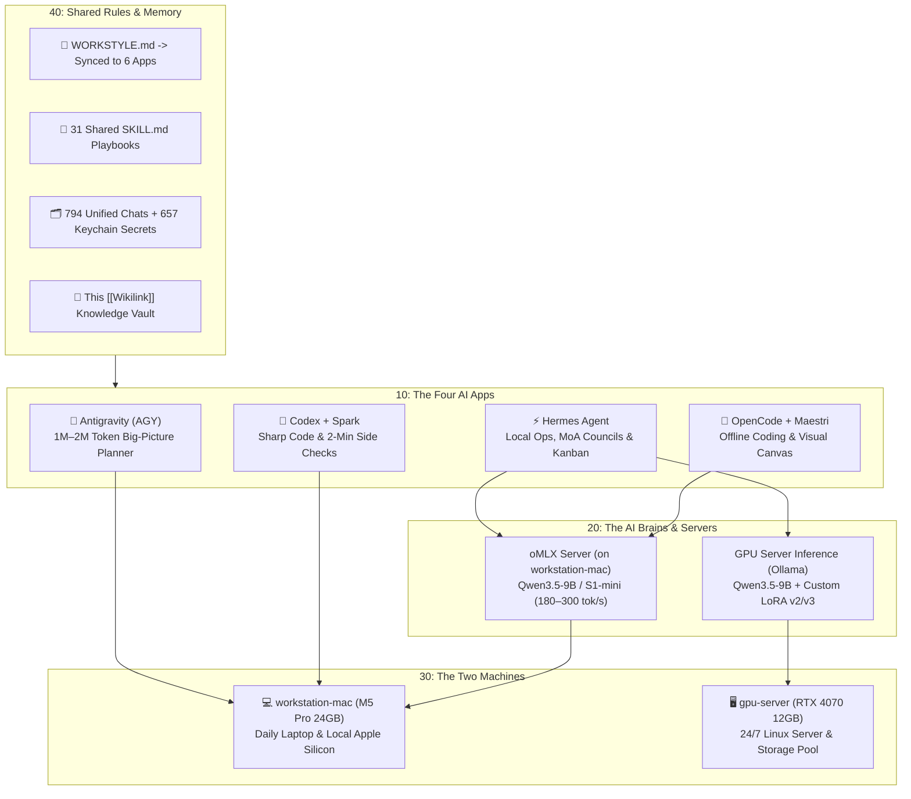

# Architecture Overview MOC (How the Whole System Fits Together)

> [!TIP]
> **The Big Picture in One Sentence**: Instead of forcing one AI tool to do everything, we split the work across **two machines** (`workstation-mac` and `gpu-server`) and **four specialized AI apps**, all following **one shared rulebook** ([[40.01-Agent-Policy]]).

See also [[70.01-Intelligence-Fit-to-Form-MOC]] for how this directly mirrors Ryan's *"Intelligence Fit to Form"* philosophy.

---

## 3 Big Decisions We Made on Oct 19, 2026

1. **Escaping the "88.8% Maintenance Sinkhole"** ([[50.02-2026-10-19-Session-Review-and-Quota-Audit]]):
   - **The Problem**: Between Oct 15 and Oct 19, **88.8%** of our AI usage went into fixing and tweaking the AI tools themselves rather than shipping real projects—while [[10.03-Codex-CLI-and-Spark]] kept hitting 5-hour usage lockouts.
   - **The Fix**: Give each AI app a clear lane:
     - **[[10.02-Antigravity-AGY]]** handles huge 1M–2M token planning, multi-file research, and visual portals (since it has 77–82% unused quota).
     - **[[10.03-Codex-CLI-and-Spark]]** is saved for surgical code reviews and fast 2-minute `spark` second opinions.
     - **[[10.04-Hermes-Agent]]** runs free local models on our own hardware for daily automation and multi-model councils.
2. **Fixing Bad AI Habits in Two Places at Once** ([[50.03-2026-10-19-Tri-Agent-Hardening-Plan-and-Walkthrough]]):
   - When an AI gets stuck in a blind search loop (`H05`) or writes broken tool tags (`T02`), we fix it twice:
     1. **In the written rules** ([[40.01-Agent-Policy]]: *"Stop after 2 empty searches and tell the user"*).
     2. **In the model's trained weights** ([[20.02-LoRA-Weight-Adapter]] `v3`: fine-tuning examples where the model stops cleanly after 1 empty search).
   - See [[70.02-Sycophancy-vs-Reflexive-Contrarianism]] for why combining prompt rules with weight tuning solves the exact behavioral drift Ryan writes about.
3. **One Shared Memory & Rulebook Across Every App**:
   - **One Rulebook**: `~/.config/agent-policy/WORKSTYLE.md` ([[40.01-Agent-Policy]]) automatically copies itself into 6 [[40.02-Policy-Sync-Target]] files.
   - **One Skill Folder**: `~/.agents/skills/` shares 31 [[40.03-Agent-Skill]] playbooks with every app.
   - **One Chat Archive**: `unify_sessions.py` collects 794 chats from 9 apps ([[40.04-Session-Ingestor]]) and strips secrets into macOS TouchID Keychain ([[40.05-TouchID-Redaction-Vault]]).
