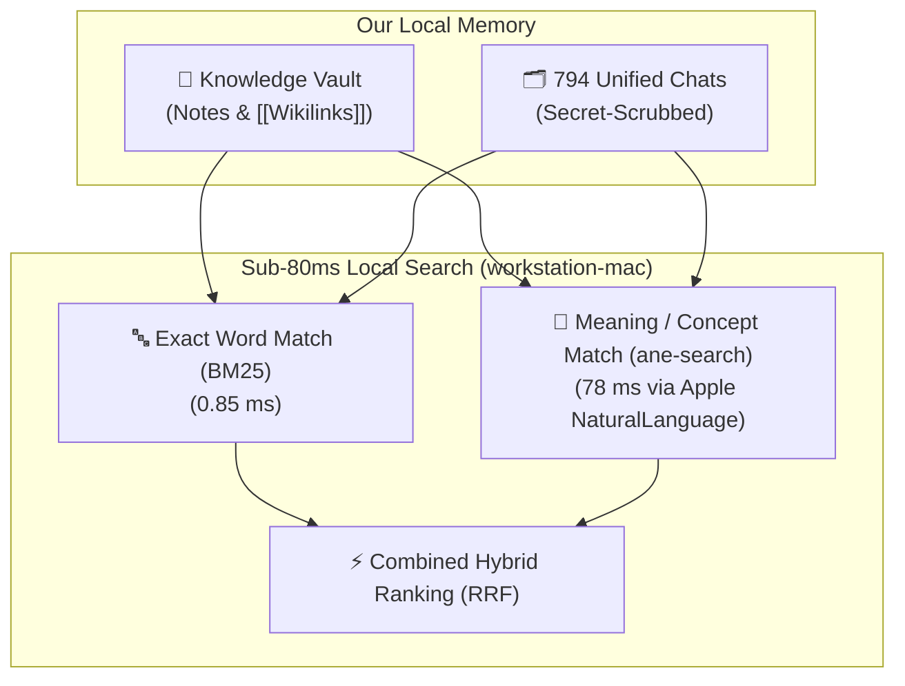

# Apple Neural Engine (ANE) Hybrid Search (Sub-80ms Local Memory)

## What It Is in Plain English

When an agent searches this vault (`~/.agents/knowledge/`) or our 794 past chats (`~/.agents/sessions/`), we don't want it to wake up a giant 10 GB model or wait on a slow cloud API.

Instead, we built **`ane-search`** in native Swift (`ANESearch.swift`) on `workstation-mac` ([[30.01-Host-Topology-MOC]]). It uses Apple's built-in system frameworks (`NaturalLanguage.framework` + `Accelerate` hardware math) to search **1,290 note chunks in under 80 milliseconds**—while leaving **oMLX** ([[20.03-Inference-Provider]]) 100% free for chatting.

---

## Why We Combine Word Search (BM25) + Meaning Search (`ane-search`)

In our Oct 20 benchmark audit ([[50.07-2026-10-20-ANE-Retrieval-Harness-and-Contention-Audit]]), we tested 25 real questions:
- **Exact Word Match (BM25)** scored **85% accuracy** (100% when searching exact names like `TouchID` or `SemVer 2.0`), taking less than **1 millisecond**.
- **Pure Meaning/Vector Search (`ane-search`)** alone only scored **40%** because vector embeddings often blur exact technical code names.
- **Hybrid Search (combining both)** gives us the best of both worlds: exact code names always match, AND paraphrased questions still find the right note (see [[70.03-Why-Agent-Browsers-Fail-Comet-vs-Harnesses]]).
