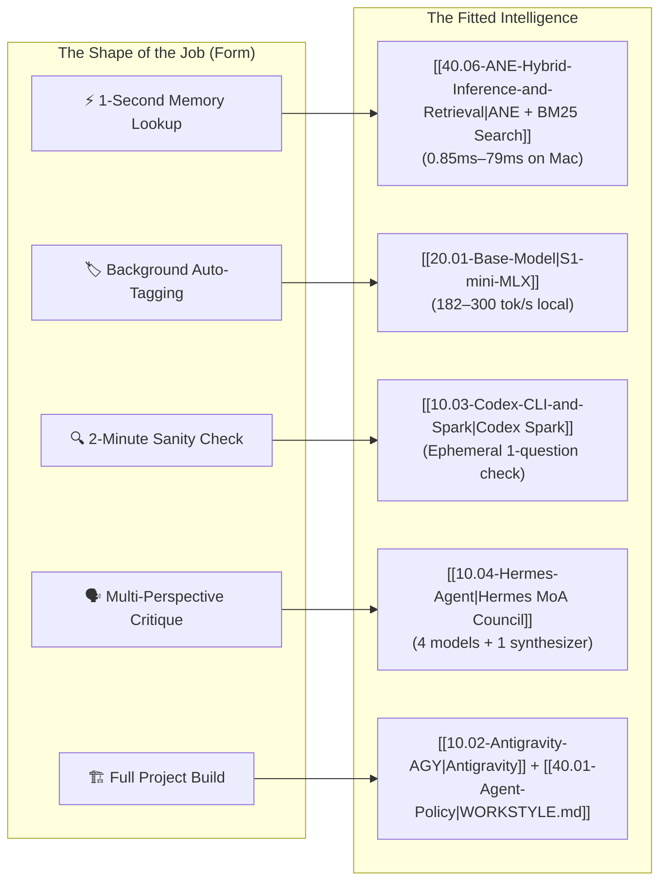

# Intelligence Fit to Form — Where Ryan & Erick Intersect

> [!TIP]
> **Why This Note Is the Center of Our Collaboration**:
> Ryan's studio (**Embroaden: *Intelligence Fit to Form***) and his *Transmutations* essays argue a simple, powerful truth: **AI fails when you pour a generic chatbot into the wrong shape of work.**
> This vault (`00–50`) is the back-end twin of that exact idea: matching the **size, speed, and personality of the AI** to the **exact shape of the job**.

---

## 1. How Ryan's Essays Map Directly to This Vault (`[[Wikilinks]]`)

| Ryan's Focus (*Transmutations* / *Embroaden*) | Matching Notes in This Vault | What We Can Build Together |
|---|---|---|
| **"Intelligence Fit to Form"** *(Matching the right model & interface to the task instead of one bloated chatbot)* | - [[00.02-Architecture-Overview-MOC]] - [[10.01-Agent-Harness]] - [[50.02-2026-10-19-Session-Review-and-Quota-Audit]] | **Task-Shape Routing**: Using a tiny 250 tok/s model (`S1-mini`) for instant tagging ([[40.04-Session-Ingestor]]), a 2-minute scout (`Spark` in [[10.03-Codex-CLI-and-Spark]]) for quick trade-offs, and a 2M-token planner ([[10.02-Antigravity-AGY]]) for big builds. |
| **Sycophancy vs. Reflexive Contrarianism** *(Why models swing from fake flattery to annoying pushback and lectures)* | - [[70.02-Sycophancy-vs-Reflexive-Contrarianism]] - [[40.01-Agent-Policy]] (`WORKSTYLE.md`) - [[20.02-LoRA-Weight-Adapter]] (`v2`/`v3`) | **Two-Layer Behavior Tuning**: Combining plain-English behavior rules (`WORKSTYLE.md` synced to 6 apps via [[40.02-Policy-Sync-Target]]) with custom LoRA weight packs so models act like calm peers—never sycophants or lecturers. |
| **"Why I Canceled Comet"** *(Why AI browsers & product layers break on real-world instructions despite good search backends)* | - [[70.03-Why-Agent-Browsers-Fail-Comet-vs-Harnesses]] - [[50.01-Evaluation-Harness]] (`H01–H06`, `T01–T15`) - [[50.04-2026-10-14-Hermes-Living-Research-Register]] | **Real-World Behavior Crash Tests**: Turning Ryan's product teardowns into automated stress tests (`H01–H06`) that catch when an agent loops blindly (`H05`) or mangles instructions (`T02`). |

---

## 2. How We Match "Form" to "Intelligence" Across 5 Tiers

---

## 3. Three Concrete Things We Can Co-Create Next

1. **Co-Design the `v4` Behavior Dataset** ([[70.02-Sycophancy-vs-Reflexive-Contrarianism]]):
   - Take the exact conversational failure patterns Ryan documents in *Transmutations* (false-positive refusals, unprompted lecturing, hedging, sycophantic filler) and bake them into our next [[20.02-LoRA-Weight-Adapter]] training run on `gpu-server`.
2. **Turn Product Teardowns into Reusable Stress Tests** ([[70.03-Why-Agent-Browsers-Fail-Comet-vs-Harnesses]]):
   - Add a **Behavioral UX Suite (`B01–B10`)** alongside `H01–H06` and `T01–T15` in [[50.01-Evaluation-Harness]] that tests whether an agent knows *when to act vs. when to ask one clear question*.
3. **Package Portable "Behavior & Policy Packs"** ([[40.01-Agent-Policy]] + [[40.03-Agent-Skill]]):
   - Use our `sync_policy.py` ([[40.02-Policy-Sync-Target]]) and `SKILL.md` format to create shareable "Intelligence Fit to Form" persona and workflow packs that work across Claude, ChatGPT/Codex, Gemini, and local models.
